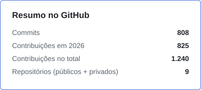
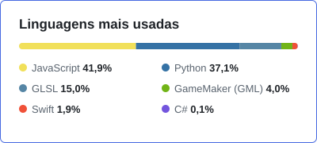
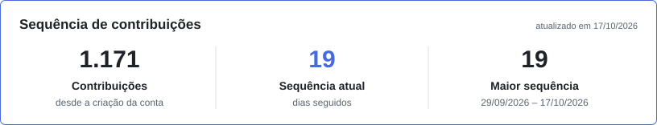

## Olá, Eu sou o Jean 👋
### Bem vindo(a)! 😎

- 💻 Desenvolvedor Full Stack — Python e Django
- 🎮 Desenvolvedor de jogos indie em GameMaker
- 🌌 Criando shaders para Minecraft em GLSL
- 🤖 Construindo ferramentas que deixam agentes de IA trabalharem junto comigo
- 📺 Programando ao vivo no YouTube e na Twitch

##

<!--
  O card "Resumo no GitHub" vem do github-stats-extended e só conta os repositórios privados
  enquanto o login com "GitHub Private Access" estiver ativo em https://github-stats-extended.vercel.app/frontend
  Se ele voltar a mostrar só os números públicos (ex.: 34 commits, rank C), troque a linha 
  abaixo por este bloco, que usa o card gerado pela Action (.github/workflows/cards.yml):

  <picture>
    <source media="(prefers-color-scheme: dark)" srcset="assets/resumo-dark.svg">
    
  </picture>
-->

  
  <picture>
    <source media="(prefers-color-scheme: dark)" srcset="assets/linguagens-dark.svg">
    
  </picture>
   
  <picture>
    <source media="(prefers-color-scheme: dark)" srcset="assets/sequencia-dark.svg">
    
  </picture>
   
  Os números incluem repositórios privados e são atualizados todo dia.

##

### ⭐ Em destaque

  
  
   
  

##

### 🛠️ Projetos em andamento
> 🔒 Repositórios privados

| Projeto | Sobre |
|---|---|
| 🌌 **Jetlight** | Shader pack para Minecraft Java (Iris) com motor de renderização próprio, escrito do zero: iluminação deferida, sombras do sol com vidro colorido e um céu com identidade própria — estrelas, aurora, nebulosa e eventos celestes como chuva de meteoros e cometas. Funciona com Distant Horizons e Voxy. |
| 👻 **GMGhost** | Servidor MCP em Python + ponte em GML que deixa um agente de IA abrir, ver, jogar e testar um jogo do GameMaker rodando — um "Playwright" para jogos. |
| 💰 **WalletPI** | Gestão financeira pessoal em Django: receitas e despesas por categoria, metas, carteira de investimentos com importação de notas de corretagem e exportação em PDF/Excel. |
| 🤖 **JitaBOT** | Bot do **Jet Hub**, meu servidor de Discord para quem faz jogos. Online 24h, com slash commands e formulários: cartões de projeto e devlogs, sorteio de ideias, pomodoro em call, lembretes, conversor de cores e paletas (23 formatos), tickets, sorteios, eventos, aniversários, avisos de vídeo e live do YouTube e moderação. |
| 📺 **Overlay 2.0** | Overlay das minhas lives para o OBS: telas de início, pausa e encerramento, molduras de gameplay e programação, com painel de controle e temas (pixel, neon, terminal). |
| 🖥️ **TCM JetVersion** | Minha versão do [Ticlin's Claude Monitor](https://github.com/LucasM-Maciel/ticlins-claude-monitor): uma janelinha que acompanha as sessões do Claude Code e avisa com som quando uma precisa de mim, com temas e personagens meus. |
| 🎒 **BagBreaker** | Jogo clicker/idle em GameMaker, com suporte a vários idiomas. |
| 📚&nbsp;**JetLibraryGM** | Minha biblioteca pessoal de funções reutilizáveis para GameMaker. |

##

### 🎮 Meus jogos

<table>
  <tr>
    <td align="center"><a href="https://jetodev.itch.io/pacdimensional"> <b>PacDimensional</b></a> Plataforma · NoneJam12</td>
    <td align="center"><a href="https://jetodev.itch.io/mirroed"> <b>Mirroed</b></a> Puzzle · Almas Espelhadas</td>
    <td align="center"><a href="https://jetodev.itch.io/santa-goes-snowyfast"> <b>Santa Goes Snowy Fast!</b></a> Sobrevivência</td>
  </tr>
  <tr>
    <td align="center"><a href="https://jetodev.itch.io/knights-fall"> <b>Knight's Fall</b></a> Plataforma · Protótipo</td>
    <td align="center"><a href="https://jetodev.itch.io/a-vinganca-de-krampus-proteja-o-natal"> <b>A Vingança de Krampus</b></a> Proteja o Natal</td>
    <td align="center"></td>
  </tr>
</table>

##

### 🧰 Tecnologias

  
  
  
  
  
   
  
  
  
  
   
  
  

##

  
  
  
  

